# The City That Comes Into Focus

**Stability-aware progressive visualization of Istanbul's evening traffic**

A map of Istanbul's weekday evening traffic that is revealed one evening at a time. Each area is drawn sharply only once its speed estimate has stopped moving. Uncertain areas stay blurred, and areas whose traffic suddenly changes are flagged. The map shows what the data says and how far you can trust it.

**[Open the live map →](https://saynasarvar.github.io/city-comes-into-focus/)**

<p align="center">
  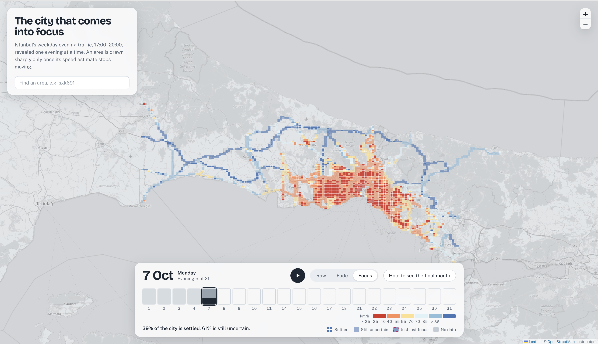
</p>

---

## Contents

1. [The question](#1-the-question)
2. [Data](#2-data)
3. [Method](#3-method)
4. [Results](#4-results)
5. [The interactive map](#5-the-interactive-map)
6. [Limitations](#6-limitations)
7. [Possible extensions](#7-possible-extensions)
8. [Repository structure](#8-repository-structure)
9. [Reproducing the project](#9-reproducing-the-project)
10. [Credits](#10-credits)

---

## 1. The question

When data arrives bit by bit (live sensor feeds, the first days of a study, streaming analytics), people tend to read an early map as if it were final. Early estimates can be wrong, and an ordinary map gives no hint which parts to trust.

> **When can we trust what a progressive map shows, and how should the map communicate it?**

This project answers that question for one concrete case. It builds a rule that decides, area by area and evening by evening, whether an estimate has *settled*. It tests that rule against a simpler baseline, and then designs a map that makes the difference visible.

Throughout, **stability is not treated as correctness**. A settled estimate is one that is consistent so far; it can still be overturned by a sudden change.

---

## 2. Data

| | |
|---|---|
| **Source** | Istanbul Metropolitan Municipality Open Data Portal, [Hourly Traffic Density Data Set](https://data.ibb.gov.tr/en/dataset/hourly-traffic-density-data-set) |
| **Period** | October 2024 |
| **Unit** | one geohash-6 cell (about 0.6 × 0.9 km) in one hour |
| **Fields used** | `DATE_TIME`, `GEOHASH`, `LATITUDE`, `LONGITUDE`, `AVERAGE_SPEED`, `NUMBER_OF_VEHICLES` |
| **Raw size** | 1,769,643 rows, 2,458 cells, 744 hours |
| **Licence** | Istanbul Metropolitan Municipality Open Data License |

### Data quality checks

| Check | Result |
|---|---|
| Missing values | none |
| Duplicate (cell, hour) rows | none |
| Hours present | all 744 |
| Impossible values (min > max, average outside [min, max]) | none |
| Data outage | 10 Oct, 10:00: only 35 cells reported instead of ~2,400 (outside the analysis window) |
| Cell-hours with fewer than 5 vehicles | 6.42% of rows, mostly at night (about 19% at 03:00, 3.17% in the evening window) |
| Average speed above 150 km/h | 49 rows, **all** in cell-hours with fewer than 5 vehicles |
| `LATITUDE` / `LONGITUDE` | exactly the centres of the geohash cells (checked by decoding) |

<p align="center">
  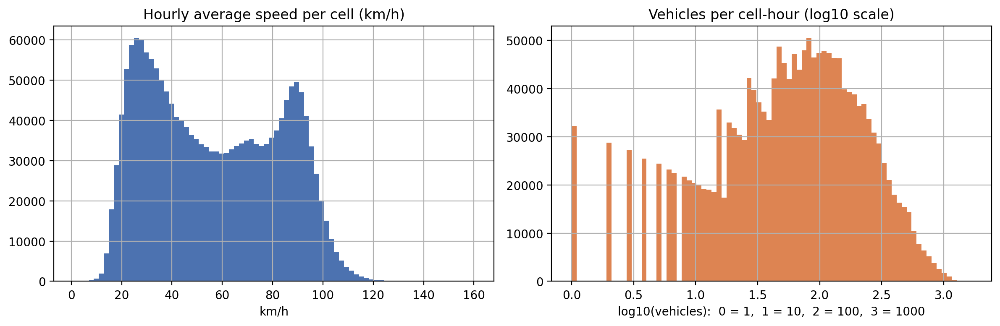
</p>

Speeds are **bimodal**: one peak around 25–30 km/h (congested streets) and one around 85–90 km/h (highways).

---

## 3. Method

### 3.1 Pipeline

```
Raw CSV (1.77 M rows: cell × hour)
   │  notebooks/01_data_preparation.ipynb
   ▼
daily_evening.parquet  — 2,406 cells × 21 evenings (one value per cell per evening)
   │  notebooks/02_stability.ipynb
   ▼
progress.parquet       — running mean, 95% interval and state for every cell and evening
   │  notebooks/03_export.ipynb
   ▼
docs/data/cells.geojson — cell rectangles + 21 daily values each (1.47 MB)
   │  docs/index.html · style.css · app.js
   ▼
Interactive map (Leaflet)
```

### 3.2 Cleaning and analysis window

Every choice below was checked with the data before it was made.

| Decision | Choice | Evidence |
|---|---|---|
| Noise filter | drop cell-hours with fewer than 5 vehicles | removes 113,575 rows (6.42%), mostly at night; also removes all 49 speeds above 150 km/h |
| Time window | weekdays 17:00–20:00 | slowest hour of the day is 18:00 (50.8 km/h); spread between areas is 28.1 km/h vs 25.2 km/h over the whole day |
| Excluded days | 28 Oct (half-day holiday) and 29 Oct (Republic Day) | city-wide evening speed 54.4 and 55.2 km/h vs a median of 51.4 km/h on other weekdays |
| Unit of evidence | one value per cell per evening (mean of up to 3 evening hours) | hours in the same evening are strongly dependent; separate evenings are new evidence |
| Minimum coverage | at least 15 of 21 evenings | 2,363 cells kept; 43 shown as *no data* |

<p align="center">
  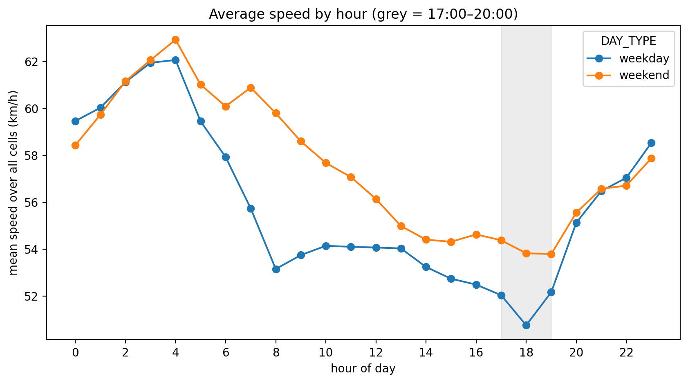
  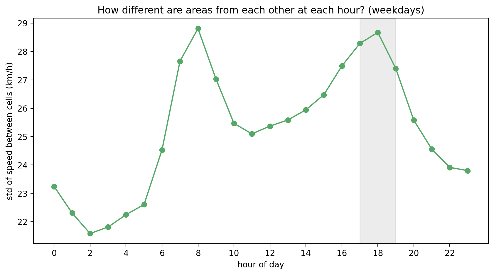
</p>
<p align="center">
  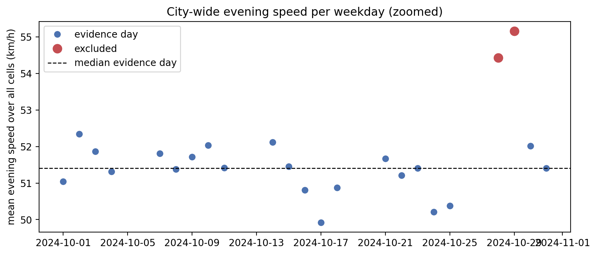
</p>

### 3.3 Progressive estimates

The month is replayed evening by evening. After *t* evenings have been revealed (t = 1 … 21), each cell has:

| Quantity | Meaning |
|---|---|
| *n* | number of evenings with data so far |
| running mean | the value the map shows at that moment |
| 95% half-width | uncertainty of the mean: *t*-critical × std / √*n* |

The *t* multiplier is large when few evenings are available (12.7 at *n* = 2), so early intervals are honestly wide.

### 3.4 Three rules for "settled"

| Rule | A cell is *settled* when… |
|---|---|
| **A** (change only) | its running mean moved less than **1 km/h** over the last 3 evenings, and *n* ≥ 5 |
| **B** (change + uncertainty) | rule A, **and** its 95% interval is narrower than **±2 km/h** |
| **H** (B + hysteresis) | it **enters** with rule B, then **stays** settled while it moves less than 1.5 km/h and the interval stays under ±2.5 km/h |

Rule H is used for the map. Hysteresis stops areas from flickering in and out of focus because of tiny wobbles.

### 3.5 Evaluation

Each rule is judged against the **final value** (the mean over all 21 evenings).

- A settled cell is counted as **wrong** if its shown value is more than **3 km/h** from the final value (in the map's *peek* view, "wrong" means it lands in a different colour class).
- Errors shrink automatically near day 21, because the final value *is* the day-21 value. Rules are therefore compared mainly on **days 5–14**.

---

## 4. Results

### 4.1 Areas differ a lot in how predictable they are

| Day-to-day spread of a cell's evening speed | km/h |
|---|---|
| 25th percentile | 1.30 |
| median | 2.06 |
| 75th percentile | 3.60 |
| maximum | 19.54 |

<p align="center">
  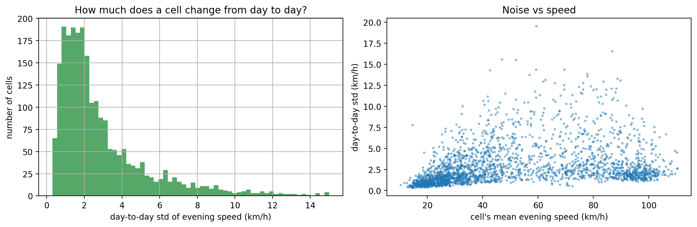
</p>

**Finding 1.** The always-congested areas (below 30 km/h) are the most predictable, varying by about 1 km/h from evening to evening. The noisiest areas are mid-to-fast roads (40–90 km/h), which are free-flowing on some evenings and jammed on others. This was the opposite of the initial expectation.

**Finding 2.** Some areas have a trend over the month rather than random noise. A rule that only looks at recent change can wrongly call such areas settled.

### 4.2 Adding uncertainty halves premature conclusions

| Evenings revealed | A: settled | A: wrong | B: settled | B: wrong | H: settled | H: wrong |
|---|---|---|---|---|---|---|
| 5 | 59.2% | 4.4% | 39.1% | 1.5% | 39.1% | 1.5% |
| 7 | 76.6% | 3.6% | 55.6% | 1.4% | 57.1% | 1.6% |
| 10 | 89.3% | 3.1% | 69.4% | 1.5% | 70.6% | 1.6% |
| 12 | 90.9% | 2.4% | 73.6% | 1.3% | 75.1% | 1.4% |
| 14 | 90.4% | 1.1% | 75.8% | 0.7% | 77.2% | 0.7% |

*"Wrong" = share of settled cells more than 3 km/h from the final value.*

<p align="center">
  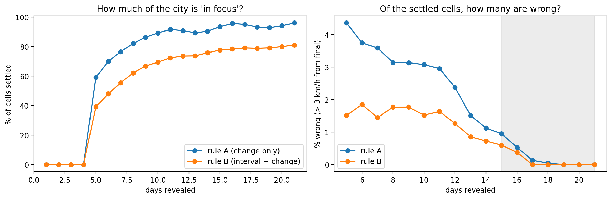
</p>

At evening 10, rule A is wrong in **65** settled cells and rule B in **25**. The 40 mistakes that B avoids are noisy cells that only looked flat (median half-width 3.76 km/h). The 25 that remain are calm and precise (median half-width 1.41 km/h) but change later.

### 4.3 The result holds across settings

Evening 10, nine combinations of interval limit (*W*) and error tolerance (*TOL*):

| W (km/h) | TOL (km/h) | A: settled | A: wrong | B: settled | B: wrong | Mistakes cut by B |
|---|---|---|---|---|---|---|
| 1.5 | 2 | 89.3% | 5.9% | 56.0% | 2.1% | 64.0% |
| 1.5 | 3 | 89.3% | 3.1% | 56.0% | 1.1% | 65.6% |
| 1.5 | 5 | 89.3% | 1.1% | 56.0% | 0.5% | 58.4% |
| **2.0** | 2 | 89.3% | 5.9% | 69.4% | 2.7% | 53.3% |
| **2.0** | **3** | **89.3%** | **3.1%** | **69.4%** | **1.5%** | **50.5%** |
| **2.0** | 5 | 89.3% | 1.1% | 69.4% | 0.7% | 38.5% |
| 3.0 | 2 | 89.3% | 5.9% | 80.1% | 3.5% | 39.7% |
| 3.0 | 3 | 89.3% | 3.1% | 80.1% | 1.8% | 39.9% |
| 3.0 | 5 | 89.3% | 1.1% | 80.1% | 0.8% | 22.4% |

Rule B makes fewer mistakes than rule A in **all nine** settings (22–66% fewer). A stricter interval limit settles less of the city and avoids more mistakes.

### 4.4 Hysteresis removes flicker almost for free

| | Rule B | Rule H |
|---|---|---|
| "Lost focus" events (settled one evening, not the next) | 450 | **162** (−64%) |
| Wrong at evening 10 | 1.5% | 1.6% |

### 4.5 How the city comes into focus (rule H)

| Evenings revealed | Forming | Settling | Settled |
|---|---|---|---|
| 3 | 100% | 0% | 0% |
| 5 | 1.4% | 59.5% | 39.1% |
| 10 | 0% | 29.4% | 70.6% |
| 15 | 0% | 21.5% | 78.5% |
| 21 | 0% | 17.9% | 82.1% |

About **18% of the city never settles** within the month.

<p align="center">
  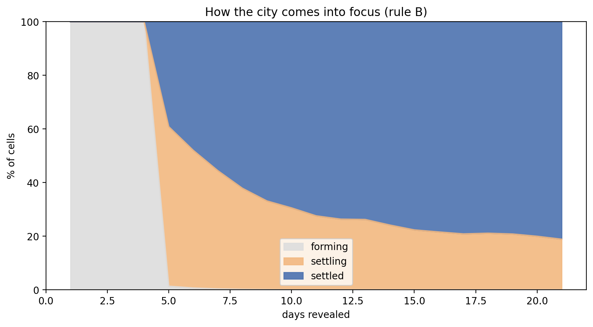
</p>

### 4.6 What the remaining errors are

The errors that survive rule B are **sudden changes**, which no rule based on past evenings can foresee.

**Example: area `sxk691` on road D-020.** It is steady at about 88 km/h for 13 evenings and is settled with an interval of ±1.8 km/h. From 18 October it drops to about 60 km/h and stays there. The final month value is 77.7 km/h. The rule correctly drops the area out of focus on the first evening of the change (interval widens to ±4.3 km/h), and the neighbouring area on the same road loses focus on the same evening.

<p align="center">
  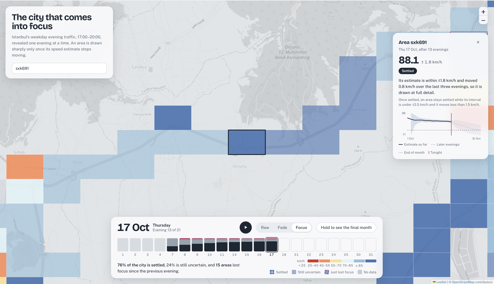
  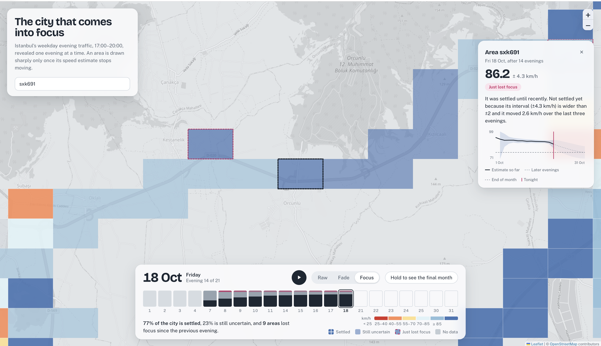
</p>

**Finding 3.** The areas that fail cluster along road segments rather than appearing at random, suggesting whole stretches of road changed together.

<p align="center">
  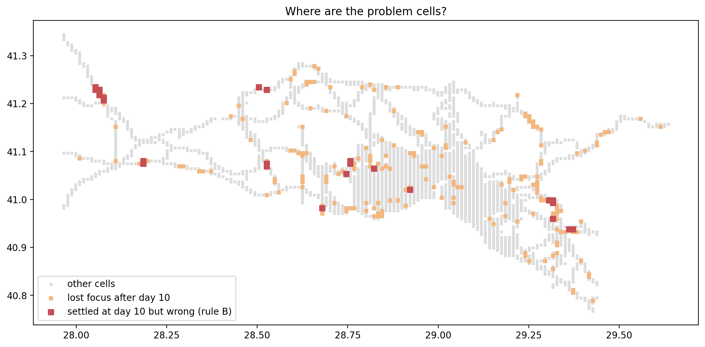
</p>

**Finding 4.** The two slowest city-wide evenings of the month, 17 and 24 October, are followed by spikes in the number of areas losing focus.

<p align="center">
  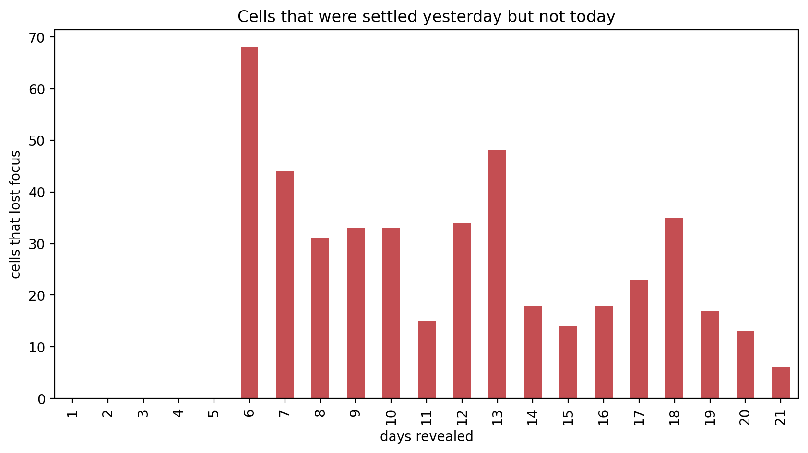
</p>

---

## 5. The interactive map

### 5.1 Visual encoding

Colour shows **speed**. Texture shows **how far to trust it**.

| On the map | Meaning |
|---|---|
| Sharp tile with a white border | **Settled**: trustworthy at the scale of one area |
| Smooth patch, no borders | **Still uncertain**: drawn at the average of its ~5 km block (geohash-5 parent), because only the area-level value is claimed |
| Dashed magenta outline | **Just lost focus**: was settled in the last two evenings; drawn with its own value so the change is not averaged away |
| Grey | **No data**: fewer than 15 evenings with enough traffic |

Speed classes: < 25, 25–40, 40–55, 55–70, 70–85, ≥ 85 km/h (ColorBrewer red–yellow–blue). The two peaks of the speed distribution fall into clearly different colours.

### 5.2 Why the design looks like this

Each feature responds to a problem seen in the previous version.

| Version | Problem it revealed | Next step |
|---|---|---|
| Raw map | the map on evening 1 looks as confident as on evening 21 | encode stability |
| Fade (opacity) | faded colours can be misread as a different speed class | blend uncertain areas into coarser blocks instead |
| Focus (block blending) | averaging hid sudden changes such as `sxk691` | keep recently changed areas at their own value, with a warning outline |
| Peek at final month | makes premature conclusions visible | — |

<table>
  <tr>
    <td align="center">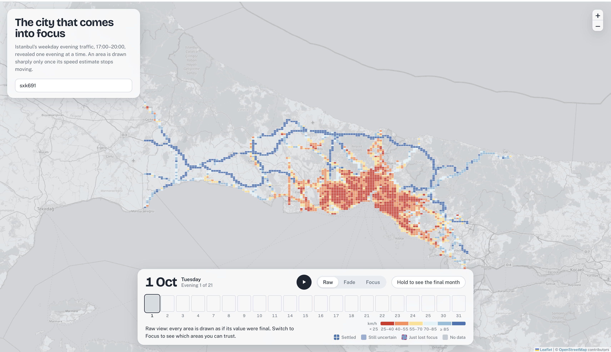<br><sub>Raw view, evening 1: everything looks certain</sub></td>
    <td align="center">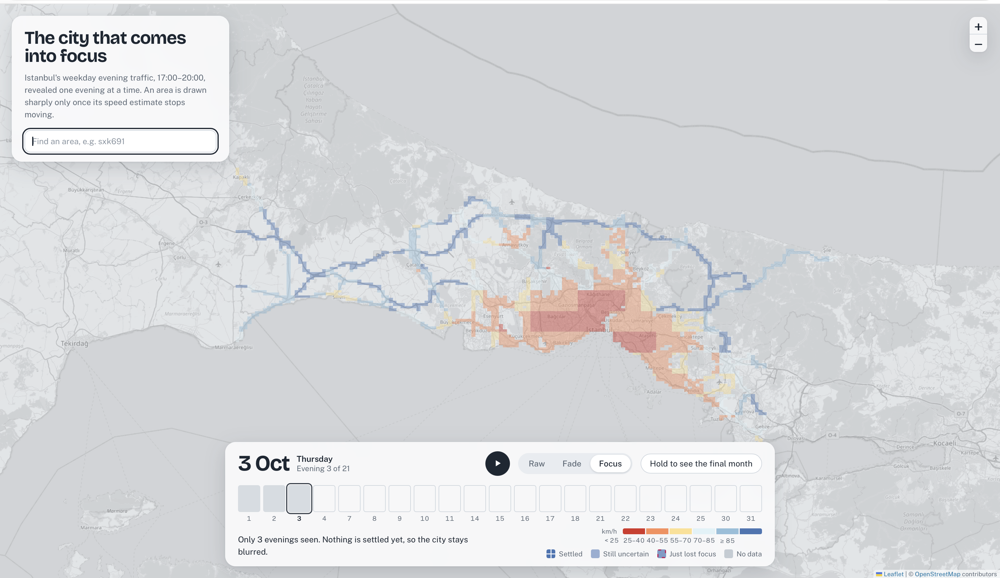<br><sub>Focus view, evening 3: a blurred city</sub></td>
  </tr>
  <tr>
    <td align="center"><br><sub>Evening 5: the congested centre settles first</sub></td>
    <td align="center">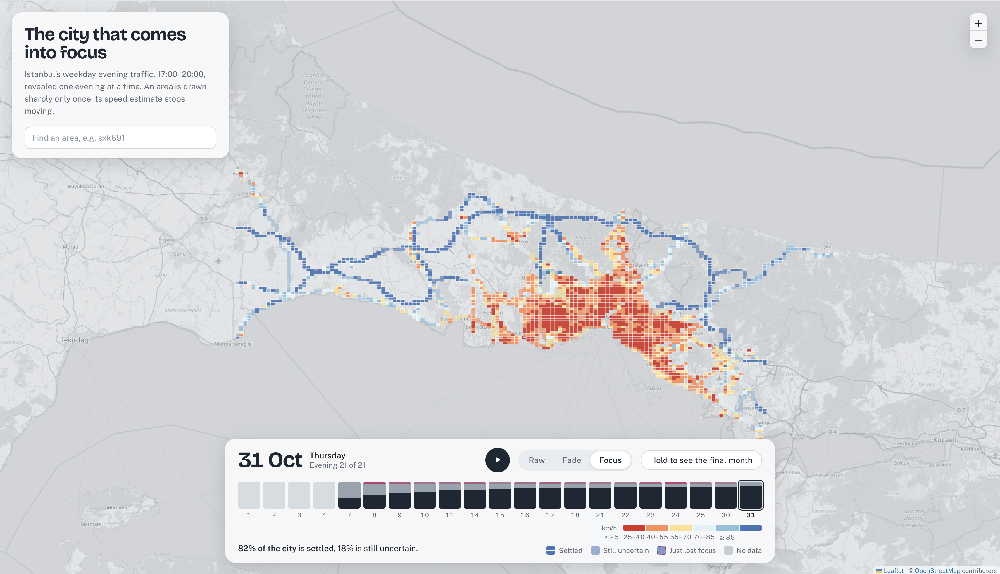<br><sub>Evening 21: 82% settled; the rest never settles</sub></td>
  </tr>
</table>

### 5.3 Features

| Feature | How to use it |
|---|---|
| **Focus strip** | 21 bars, one per evening, showing how much of the city was settled (dark), settling (grey) or forming (light). A magenta mark means areas lost focus that evening. Drag across it, or use the arrow keys. Evenings not yet revealed are empty. |
| **Play** | Plays the month evening by evening. It also starts once on page load (not for users who prefer reduced motion). |
| **Raw / Fade / Focus** | Three ways of drawing the same data: no uncertainty, faded uncertainty, and block-blended uncertainty. |
| **Area details** | Click any area: current estimate and interval, status, a plain-language reason, and a small chart of the estimate over the month. |
| **Search** | Type a geohash code (e.g. `sxk691`) to zoom to that area. |
| **Hold to see the final month** | Hold the button, or the **F** key: the final month is shown and settled areas that are in the wrong colour tonight are outlined. |

<p align="center">
  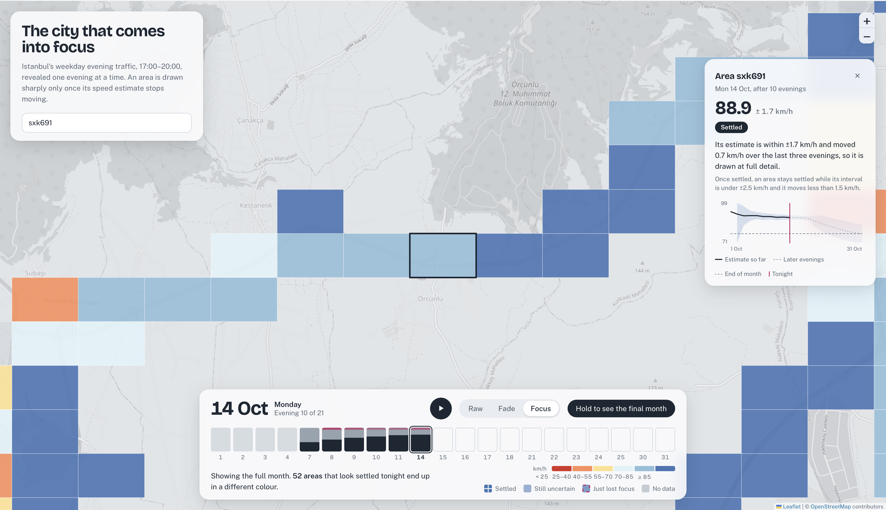
</p>

### 5.4 Areas worth looking at

| Area | What it shows |
|---|---|
| `sxk691` | settled and confident, then a sudden drop after 17 October |
| `sxk4xb` | jumps from about 65 to about 90 km/h mid-month; never trusted |
| `sxk3bt` | a slow downward trend over the month |
| `sxk9n7` | a congested area that settles early and stays settled |
| `sxk9x2` | a highway with occasional jammed evenings; never settles |

---

## 6. Limitations

1. **Stable is not correct.** Sudden changes cannot be foreseen from past evenings.
2. **The final value is a reference, not ground truth.** It is simply the best estimate available at the end of the month.
3. **Evenings are not fully independent.** City-wide slow evenings show shared effects, so the intervals are probably too narrow.
4. **Thresholds are judgement calls.** This is why nine combinations were tested.
5. **Block averages can mix road types.** A 5 km block containing a highway and city streets can produce a middle value that matches neither, and block edges can create artificial colour steps along a road.
6. **Opacity changes colour lightness** in the Fade view; this is the motivation for the Focus view.
7. **No user study.** It has not yet been tested whether people make better judgements with the Focus view.
8. **Scope:** one month, one city, one time window.

---

## 7. Possible extensions

**Analysis**
- Other time windows (the morning rush has similarly large differences between areas) and other months.
- Detect sudden changes directly with a change-point method instead of only reacting to them.
- Use neighbouring areas: a change shared by a whole road segment is more likely to be real.
- Group uncertain areas by road type as well as location, to avoid mixing highways and streets.
- Shuffle the order of evenings to test how much the conclusions depend on which evenings come first.

**Evaluation**
- A small user study comparing the Raw and Focus views on questions such as *"Is this area slow?"*, measuring how often people draw premature conclusions.

**Visualization and XR**
- A tabletop 3D or AR version of the same data: column height for speed, sharpness for stability.
- An audio version in which uncertain areas sound blurred.

---

## 8. Repository structure

```
city-comes-into-focus/
├── README.md
├── requirements.txt
├── .gitignore
├── notebooks/
│   ├── 01_data_preparation.ipynb   # audit, cleaning, window choice, cell × evening table
│   ├── 02_stability.ipynb          # progressive estimates, rules A/B/H, evaluation, states
│   └── 03_export.ipynb             # geohash decoding, GeoJSON export
├── data/
│   ├── raw/                        # original CSV (not in the repository; see below)
│   └── processed/
│       ├── daily_evening.parquet   # 2,406 cells × 21 evenings
│       ├── cells.csv               # location and summary per cell
│       └── progress.parquet        # mean, interval, n, state per cell and evening
├── docs/                           # the website (served by GitHub Pages)
│   ├── index.html
│   ├── style.css
│   ├── app.js
│   └── data/cells.geojson
└── assets/                         # screenshots and figures for this README
```

---

## 9. Reproducing the project

### Requirements

Python 3.10 or newer.

```bash
pip3 install -r requirements.txt
```

### Steps

1. Download *Traffic Density Data for October 2024* from the [IBB Open Data Portal](https://data.ibb.gov.tr/en/dataset/hourly-traffic-density-data-set) and save it as `data/raw/traffic_density_202410.csv`.
2. Run the notebooks in order: `01_data_preparation`, `02_stability`, `03_export`.
3. Start a local server and open the map:

```bash
cd docs
python3 -m http.server 8000
```

Then open <http://localhost:8000>. (Opening `index.html` directly does not work, because browsers block loading the data file from disk.)

---

## 10. Credits

- **Data:** Istanbul Metropolitan Municipality (İBB) Open Data Portal, under the İBB Open Data License.
- **Map tiles:** © OpenStreetMap contributors.
- **Libraries:** pandas, NumPy, SciPy, Matplotlib, Leaflet.
- **Colour scale:** ColorBrewer (RdYlBu).
- **Fonts:** Bricolage Grotesque and Public Sans (Google Fonts).

**Author:** Sayna Sarvar · B.Sc. Computer Engineering, University of Zanjan
